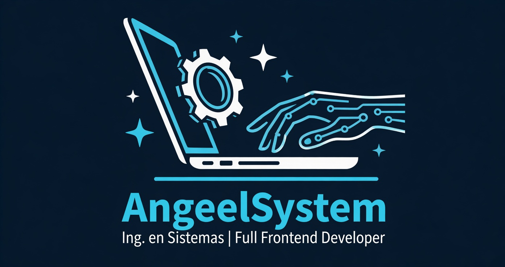

  

  # Ángel Valencia

  **Desarrollo frontend · React · JavaScript · Aplicaciones web**

  Estudiante de Ingeniería en Sistemas Computacionales · México 🇲🇽

  [**Portafolio**](https://angeelsystem.vercel.app/) · [**LinkedIn**](https://www.linkedin.com/in/valencia-lopez-556499317) · [**Contacto**](mailto:angeelsystem@gmail.com)

---

### Sobre mí

Me interesa construir aplicaciones web que sean claras, funcionales y fáciles de mantener. Disfruto transformar necesidades reales en interfaces útiles, integrar funcionalidades y aprender a partir de proyectos que puedo probar y mejorar.

Actualmente curso **Ingeniería en Sistemas Computacionales en el Instituto Tecnológico de Villahermosa**. Mi enfoque principal es el **desarrollo frontend**, con experiencia práctica en proyectos con React y Vite y exploración de herramientas del lado del servidor.

> **Objetivo 2027:** realizar mi residencia profesional entre **enero y junio de 2027**, colaborando en desarrollo web o de software.

### Tecnologías y herramientas

| Área | Herramientas |
| --- | --- |
| **Frontend** | HTML, CSS, JavaScript, React, Vite |
| **Desarrollo y colaboración** | Git, GitHub, npm, VS Code |
| **Otras herramientas utilizadas** | Node.js, Express, despliegues con Vercel |

Me interesa seguir profundizando en **TypeScript, backend, APIs y arquitectura de aplicaciones**.

### Proyectos

#### ⚡ [SwitchLogic — gestión visual de switches](https://github.com/angeelvaleen/SwitchLogic)
Aplicación web para organizar información de switches de red y sus puertos. Incluye formularios de configuración, estados, persistencia local y exportación de información a CSV.

**Tecnologías:** React, JavaScript, Vite.  
[Ver código](https://github.com/angeelvaleen/SwitchLogic) · [Abrir demo](https://mi-red-seven.vercel.app/)

#### 🏦 [BancoSys — atención bancaria](https://github.com/angeelvaleen/Bancosys)
Proyecto web con interfaces para distintos momentos del proceso de atención bancaria, incluyendo recepción, monitoreo y paneles de operación.

**Tecnologías visibles en el repositorio:** HTML, CSS, JavaScript.  
[Ver código](https://github.com/angeelvaleen/Bancosys)

#### 🌐 [Portafolio personal](https://github.com/angeelvaleen/mi-portafolio)
Sitio donde reúno mi perfil, proyectos y medios de contacto. Desarrollado con componentes de React, navegación por secciones y una interfaz personalizada.

**Tecnologías:** React, Vite, JavaScript; Node.js y Express para componentes del servidor.  
[Ver código](https://github.com/angeelvaleen/mi-portafolio) · [Visitar portafolio](https://angeelsystem.vercel.app/)

### Qué busco aportar

- Desarrollar interfaces **responsivas, accesibles y mantenibles**.
- Integrar funcionalidades y conectar componentes con servicios web.
- Trabajar con Git y GitHub, recibir revisiones de código y documentar lo construido.
- Aprender de un equipo de desarrollo mientras aporto soluciones concretas.

---

  <strong>¿Tienes un proyecto o una oportunidad de residencia profesional?</strong>

  Puedes escribirme a **[angeelsystem@gmail.com](mailto:angeelsystem@gmail.com)**  
  o consultar mi **[portafolio](https://angeelsystem.vercel.app/)**.

  Menos insignias, más proyectos que se pueden revisar.

